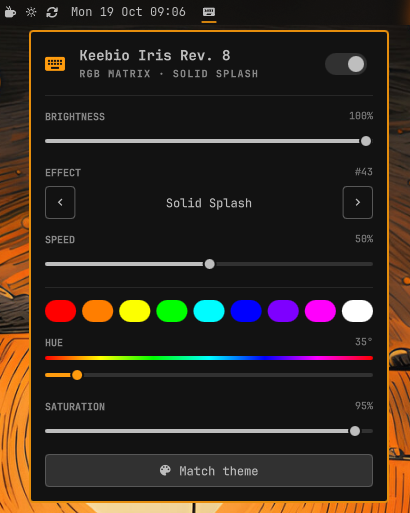

# QMK RGB for Omarchy

An [Omarchy](https://omarchy.org) bar widget that controls the RGB lighting of
QMK keyboards over the [VIA](https://www.caniusevia.com/) raw HID protocol. You
don't need to flash firmware or install packages.



Click the keyboard icon for brightness, effect, speed, and color. Scroll on the
icon to change brightness, and right-click it to turn the lighting on or off.
In the panel, ↑/↓ picks a row, ←/→ adjusts it, Enter toggles the lighting, and
Esc closes it.

## Requirements

- Omarchy 4.0.6 or later.
- A QMK keyboard built with VIA enabled (`VIA_ENABLE = yes`). Most "VIA
  compatible" keyboards ship this way.
- RGB Matrix, RGB Light, or LED Matrix in the firmware. LED Matrix is
  single-color, so the panel hides the color controls.

## Install

```bash
omarchy plugin add https://github.com/kcotugno/omarchy-qmk-rgb.git
omarchy plugin enable kcotugno.qmk-rgb
```

If the panel shows a permission error, your user can't open the keyboard's
`/dev/hidraw*` node. Install a udev rule for your connected keyboards:

```bash
~/.config/omarchy/plugins/kcotugno.qmk-rgb/qmk_rgb.py udev-rule \
  | sudo tee /etc/udev/rules.d/60-qmk-rgb.rules
sudo udevadm control --reload && sudo udevadm trigger
```

The rule uses `TAG+="uaccess"`, so only the user logged in at the seat gets
access, and only to those keyboards.

## Uninstall

```bash
omarchy plugin remove kcotugno.qmk-rgb
sudo rm -f /etc/udev/rules.d/60-qmk-rgb.rules
sudo udevadm control --reload
rm -rf ~/.local/state/omarchy-qmk-rgb
```

The keyboard keeps the last lighting settings that were saved to it.

## Settings

Edit the widget's entry in `~/.config/omarchy/shell.json`:

| Key           | Default | Meaning |
|---------------|---------|---------|
| `autoSave`    | `true`  | Save changes to the keyboard's EEPROM 1.5s after you stop adjusting. When it's off, the panel shows a **Save to keyboard** button, and unsaved changes are lost when the keyboard is unplugged. |
| `applyToAll`  | `false` | Send every change to all connected VIA keyboards. |
| `followTheme` | `true`  | Set the keyboard color to the theme's color when you switch themes. |
| `step`        | `16`    | How much one scroll notch or arrow key changes a value (0-255 scale). |
| `effectNames` | `""`    | Comma-separated effect names, starting with effect 1. Overrides the [mapping file](#effect-names). |

**Match theme** sets the keyboard to the theme's `keyboard.rgb` color. If the
current effect ignores hue, it also switches to Solid Color. `followTheme` only
changes the color and keeps the effect. If you have a `theme-set` hook that
colors the keyboard, remove it or turn `followTheme` off.

To keep your own color across theme switches, turn `followTheme` off:

```json
{ "id": "kcotugno.qmk-rgb", "followTheme": false }
```

## Effect names

The keyboard reports effects only by number. Names come from mapping files in
[`effects/`](effects/), named `<vid>-<pid>.json` after the keyboard's USB ids
(lowercase hex). Without a mapping file, the panel shows numbers.

```json
{
  "name": "Keebio Iris Rev. 8",
  "vendorId": "0xCB10",
  "productId": "0x8256",
  "lighting": "rgb_matrix",
  "source": "https://github.com/the-via/keyboards/blob/master/v3/keebio/iris/iris-rev8.json",
  "preset": "via-qmk-rgb-matrix"
}
```

- `lighting` is `rgb_matrix`, `rgblight`, `led_matrix`, or `legacy`.
- `preset` uses a shared list from `effects/presets/`. `effects` gives the list
  directly, in VIA's dropdown format: an entry's position is its effect number
  (0 is "off"), or use `["Name", number]` pairs.
- An entry can be an object, `{ "name": "Solid Color", "controls": ["hue",
  "saturation"] }`. `controls` lists which of `speed`, `hue`, and
  `saturation` the effect uses, and the panel hides the rest. Cite where they
  came from in `controlsSource`.
- `source` (required) says where the names came from. `notes` is optional.

To add a keyboard, find its VIA definition in
[the-via/keyboards](https://github.com/the-via/keyboards/tree/master/v3) (or
run `qmk_rgb.py list` for the ids). If its `menus` include `"qmk_rgb_matrix"`,
use `"preset": "via-qmk-rgb-matrix"`. Otherwise, copy the custom menu's effect
`options` into `effects`. Then run the tests, which check every mapping file.

## Command line

`qmk_rgb.py` also works on its own, for example from Hyprland bindings:

```bash
qmk_rgb.py list                          # connected VIA keyboards
qmk_rgb.py status                        # current lighting as JSON
qmk_rgb.py set --brightness +10%         # 0-255, +N/-N, or N%
qmk_rgb.py set --effect next             # next/prev wrap around
qmk_rgb.py set --color '#ff8800' --save  # --save writes to EEPROM
qmk_rgb.py set --toggle -d all           # -d: index, vid:pid, /dev/hidrawN, name, or all
```

The running panel exposes IPC methods: `toggleLighting`, `matchTheme`,
`nextEffect`, `previousEffect`, `refresh`, and `toggle`.

```bash
omarchy-shell kcotugno.qmk-rgb toggleLighting
```

## Development

```bash
python3 -m unittest discover -s tests
omarchy plugin validate .
```

To run a local checkout, symlink it to `~/.config/omarchy/plugins/kcotugno.qmk-rgb`
and enable it. Run `omarchy restart shell` after you edit `Panel.qml`.

## License

[MIT](LICENSE)
